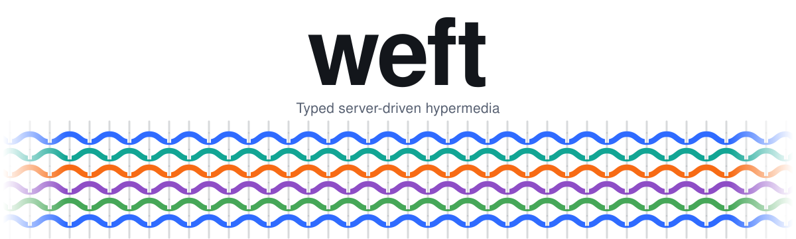

<div align="center">

# Weft

Typed server-driven hypermedia, in a superset of TypeScript.

[](LICENSE)


<picture>
  <source media="(prefers-color-scheme: dark)" srcset="docs/images/hero-dark.svg">
  
</picture>

[Quick start](#quick-start) ·
[The language](#the-language) ·
[Examples](examples/) ·
[Contributing](CONTRIBUTING.md)

</div>

Weft is a web framework for people who know TSX and are tired of shipping a
megabyte of JavaScript to render a page that is mostly text. Instead of
rendering on the server and then re-running the whole app in the browser to
attach event handlers, Weft renders once and keeps a live connection open: the
server sends small HTML diffs, the browser patches the DOM. The language,
`.wx`, is a superset of TypeScript, so your types, your editor and every npm
package you already use keep working.

> [!NOTE]
> Weft is pre-1.0 and moves fast. The compiler, runtime, server and SQLite
> data layer all work today; the API is still open to change. The status
> table near the end says what is solid and what is not.

## Why

Three things about the mainstream full-stack model bother me enough to build an
alternative.

Hydration is wasteful. Rendering HTML on the server and then booting the same
components again on the client, only to wire up click handlers, does the work
twice and blocks the page until the second pass finishes. Weft renders on the
server and sends diffs; the browser runs a few kilobytes of runtime, not your
whole app.

Authorization is where apps actually get breached, and it is the part every
framework hands back to you. Weft moves it into the data layer. A query is
scoped to the current actor by construction: the rule lives on the model and is
enforced down in the SQL, so reading a row you are not allowed to see is not a
bug you can write by forgetting a `where` clause.

And end-to-end types usually stop at the language edge. The moment the backend
is Rust or Go, the guarantees are gone. Weft is full-stack in one language, and
where it has to meet another backend it does so through a generated, typed
contract rather than a hand-written client.

## The language

`.wx` is TypeScript with a few constructs that make the above first-class.
Markup is part of the language, type-checked against your data, with the
permission written next to the field it guards:

```wx
model Invoice {
  owner: User
  amount: Money
  @read(actor == owner)        // only the owner can read this row
}

component InvoiceRow(invoice: Invoice) {
  view {
    <tr><td>{invoice.amount}</td></tr>
  }
}
```

Reactivity is a primitive, not a hook: `signal` and `derived`, no dependency
arrays. Components render on the server by default; mark a piece of state or a
function `client` and that island, and only that island, ships to the browser.
Forms post to server `action`s and work before any JavaScript has loaded.

Because `.wx` is a superset, the compiler lowers these constructs to ordinary
TypeScript and leaves the rest to the normal toolchain, the way JSX or Svelte
compile. Your existing dependencies are untouched.

## How it works

The toolchain is Rust: a hand-written lexer, parser, type checker and lowering
pass, with a language server and formatter alongside. Speed is the point, since
the compiler sits on the hot path of every save. The runtime and server are
TypeScript and run on Node 22.6+ (type stripping, no build step) or Bun, so npm
compatibility and quick startup come for free.

| Layer | Language | What it does |
|-------|----------|--------------|
| Compiler, CLI, LSP, formatter | Rust | Parse and check `.wx`, lower it to TypeScript, feed diagnostics to editors |
| Runtime | TypeScript | Signals, DOM morphing, the live connection, the browser client |
| Server | TypeScript | File routing, layouts, metadata, live pages, sessions, CSRF, CSP, rate limiting |
| Data | TypeScript | Models with `@read`/`@write` enforced on every query; SQLite today, Postgres planned |

## Quick start

```sh
npm create @weft-framework my-app
cd my-app && npm install
npm run dev              # http://localhost:3000, rebuild and reload on save
```

`weft new my-app` scaffolds a full multi-tenant app, with auth, a dashboard and
the component library already wired up, so you can read how the pieces fit.
Add `--minimal` for a bare starter instead.

Pages are files under `src/pages`. `blog/[slug].wx` serves `/blog/:slug` and
may export `load` and `meta`; `_layout.wx` wraps a directory, `_404.wx` handles
unknown paths, and files under `src/pages/api/` return a `Response`. Models
live in `src/models`, `weft.config.ts` holds the port, the session secret and
the site URL, and everything in `public/` is served as-is.

Pull UI components into a project, shadcn-style, with `weft add`:

```sh
weft add button card dialog
```

## Building from source

```sh
cargo build --workspace
cargo test --workspace
npm install
npm test
```

In a checkout, `weft` is `cargo run -p weft-cli --`. Check a `.wx` file, format
the tree, or run the language server your editor talks to:

```sh
cargo run -p weft-cli -- check examples/todo/TodoApp.wx
cargo run -p weft-cli -- fmt examples        # --check only lists files
cargo run -p weft-cli -- lsp                 # stdio; the VS Code extension starts it
```

Serve a single component with live reload, no project needed:

```sh
npm run dev -- examples/todo/TodoApp.wx --port 3000
```

## Repository layout

| Path | Contents |
|------|----------|
| `crates/weft-compiler/` | Lexer, parser, type checker and lowering for `.wx` |
| `crates/weft-cli/` | The `weft` command, the `weft new` starters and the `weft add` component registry |
| `crates/weft-fmt/` | The `.wx` formatter behind `weft fmt` |
| `crates/weft-lsp/` | The language server: diagnostics, hover types, completion, go-to-definition, rename |
| `editors/vscode/` | VS Code extension: `.wx` highlighting, runs `weft lsp` |
| `packages/runtime/` | Signals, components, the live protocol, DOM morphing |
| `packages/server/` | Routing, layouts, metadata, API routes, middleware, sessions, CSRF, CSP |
| `packages/data/` | Models with `@read`/`@write` on every query; SQLite driver and migrations |
| `packages/core/` | Tenancy, roles, invitations and SCIM |
| `packages/ui/`, `packages/theme/`, `packages/i18n/` | Component primitives, theming and localization |
| `packages/create-weft/` | `npm create @weft-framework` scaffolding |
| `packages/cli/` | `@weft-framework/cli`: the prebuilt `weft` binary on npm, one package per platform |
| `site/` | The project website on GitHub Pages, itself a Weft app built to static HTML |
| `examples/` | Small single-file examples, roughly one per language feature |
| `bench/` | Served-page benchmarks: TTFB, throughput, JavaScript shipped, memory per live page |

## Status

| Area | State |
|------|-------|
| Compiler, LSP, formatter | Working |
| Runtime and live pages | Working |
| Server: sessions, CSRF, CSP, rate limiting | Working |
| Data layer, authorization and migrations (SQLite) | Working |
| Multi-tenant core: roles, invites, SCIM | Working |
| Postgres driver | Planned |
| API stability | Pre-1.0, expect changes |

## Contributing

See [CONTRIBUTING.md](CONTRIBUTING.md). Report security issues privately, as
described in [SECURITY.md](SECURITY.md), not in the issue tracker.

## License

MIT, see [LICENSE](LICENSE). Copyright (c) 2026 Vakea.
